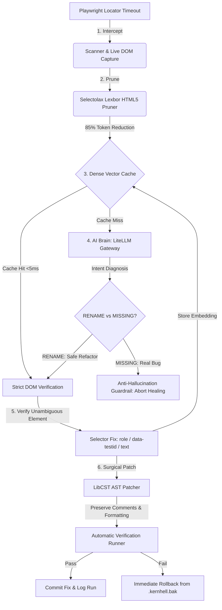

# 🔥 KernHell

> *"The Heart of Your System Where Innovation Meets Precision"*

**AI-Powered Autonomous Self-Healing Testing Engine & CLI tool for Playwright.**

[](https://www.python.org/)
[](https://nextjs.org/)
[](https://opensource.org/licenses/MIT)
[-brightgreen.svg)](https://github.com/riteshkumar072/KernHell)

---

## ⚡ The Problem

Modern frontend engineering moves fast. When developers refactor classes, IDs, or DOM wrappers (e.g., `#buy-now` becomes `#purchase-btn`), automated Playwright and Selenium test suites fail even though the business functionality works seamlessly. QA teams waste 30–40% of their time manually maintaining broken selectors.

**KernHell autonomously resolves broken selectors in real-time, preserving 100% of your code formatting, comments, and QA sanity.**

---

## 🏛️ Autonomous 6-Stage Healing Architecture



---

## 🚀 Key Features

- **Failure Interception & Live DOM Capture (`Scanner`)**: Intercepts Playwright selector timeouts and crashes, capturing the error stack trace, line number, broken selector, and live DOM snapshot (`page.content()`).
- **High-Speed Semantic DOM Pruning (`DOMPruner`)**: Strips scripts, styles, SVGs, base64 data, and non-semantic wrappers using `selectolax` to slash token usage by 80–90% while keeping semantic landmarks and accessibility roles.
- **Semantic Vector Memory (`Vector Cache`)**: 384-dimensional dense cosine index matching broken selectors against historical fixes. Resolves recurring failures in **<5ms** with zero LLM API cost.
- **Strict Anti-Hallucination Guardrails**: Distinguishes between renamed selectors (`RENAME`) and genuine missing features (`MISSING`) to prevent false-positive heals on actual product regressions.
- **Surgical LibCST AST Patching (`Patcher`)**: Surgically transforms only the target locator expression in the AST without reformatting unrelated code or stripping inline comments.
- **Automated Verification & Zero-Risk Rollback (`Verifier`)**: Re-runs the patched test in a sandbox; if it fails, immediately restores the code from `.kernhell.bak`.
- **Mission Control Dashboard (`Next.js App Router`)**: High-tech, dark-mode glassmorphic web dashboard providing live stats, real-time healing stream, semantic memory inspector, and interactive simulation playground.

---

## 📦 Installation

```bash
# Clone the repository
git clone https://github.com/riteshkumar072/KernHell.git
cd KernHell

# Install Python package in editable mode with all dependencies
pip install -e ".[all]"

# Install Mission Control dashboard dependencies
cd dashboard
npm install
cd ..
```

---

## 🛠️ CLI Usage

```text
Usage: kernhell [OPTIONS] COMMAND [ARGS]...

┌─ Commands ──────────────────────────────────────────────────────────────────┐
│ scan       Scan a test file to detect broken selectors and capture DOM      │
│            snapshots.                                                       │
│ heal       Autonomously heal broken Playwright selectors in a test file.    │
│ dashboard  Launch the KernHell Mission Control Dashboard and REST API.      │
│ ui         Alias for 'dashboard' command.                                   │
│ cache      Inspect, query, and manage KernHell's Semantic Vector Cache.     │
│ config     View and configure KernHell engine parameters.                   │
└─────────────────────────────────────────────────────────────────────────────┘
```

### 1. Scan a Test File for Broken Selectors

```bash
kernhell scan tests/test_checkout.py
```

### 2. Autonomously Heal a Test File or Suite

```bash
# Preview changes without modifying code (dry run)
kernhell heal tests/test_checkout.py --dry-run

# Surgically patch and verify fix with automatic backup
kernhell heal tests/test_checkout.py

# Batch heal all test files in a folder
kernhell heal tests/

# Export machine-readable report for CI/CD pipelines
kernhell heal tests/ --output json
```

### 3. Launch the Mission Control Dashboard

```bash
# Start FastAPI REST API and open dashboard in browser
kernhell dashboard

# Or run Next.js frontend directly:
cd dashboard
npm run dev
```

Visit **`http://localhost:3000`** to view the live dashboard and interactive playground.

### 4. Semantic Vector Memory & Cache

```bash
# List all verified cached selector mappings
kernhell cache list

# View cache hit/miss ratio and efficiency metrics
kernhell cache stats

# Purge semantic memory
kernhell cache clear
```

### 5. Engine Configuration

```bash
# Display active settings
kernhell config show

# Run the interactive configuration wizard
kernhell config init
```

---

## 🖥️ Mission Control Dashboard

The dashboard provides a production-grade operations center:

- **Overview (`/`)**: Real-time healing metrics (autonomous fixes, cache efficiency, real bugs guarded, dollar savings), live 6-stage pipeline status, and recent activity stream.
- **Interactive Playground (`/playground`)**: Test healer sandbox with pre-configured refactor scenarios and out-of-stock guardrail alerts.
- **Semantic Memory Explorer (`/cache`)**: Searchable browser for 384-dimensional dense vector embeddings with hit counts and verification badges.
- **Run History & Diffs (`/history`)**: Audit trail with side-by-side syntax-highlighted unified diffs of AST code patches.

---

## 🧪 Running the Test Suite

```bash
# Run all 59 unit and integration tests
python -m pytest -v

# Run with test coverage
python -m pytest tests/unit -v --cov=src/kernhell
```

---

## 🗺️ Execution Roadmap

- [x] **Weekend 1: Foundation (Scanner, Pruner, Core Models & CLI)**
- [x] **Weekend 2: AI Brain (Analyzer, Healer, CST Surgical Patcher & Verifier)**
- [x] **Weekend 3: Semantic Memory (Vector Cache, Embedder, Batch Healing & CI Export)**
- [x] **Weekend 4: Mission Control Dashboard (Next.js & Production Release)**

---

## 📄 License

MIT &copy; 2026 Ritesh Kumar • KernHell Systems
